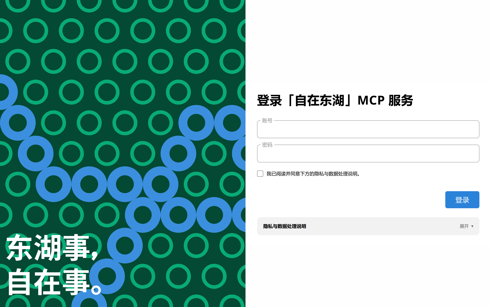

# 自在东湖 MCP 服务


基于 [自在东湖](https://github.com/SoilZhu/ChillEast) 的 MCP 服务，运行在 Cloudflare Workers 上。

> ⚠️ **这不是学校官方服务。** 本项目与湖南农业大学无关。

## 如何使用？

### 网页对话

#### ChatGPT
1. 打开并登录 <https://www.chatgpt.com>；
2. 点击“插件” -> “添加” -> “添加自定义 MCP 服务器”；
3. 填入 MCP 服务器地址 `https://mcp.chilleast.soilzhu.su/mcp`；
4. 点击“创建为插件”；
5. 跳转登录页面后登录：


#### Gemini
1. 打开并登录 <https://gemini.google.com>；
2. 点击“更多” -> “自定义” -> “关联应用” -> “添加自定义”；
3. 填入 MCP 服务器地址 `https://mcp.chilleast.soilzhu.su/mcp`；
4. 点击“下一步”；
5. 跳转登录页面后登录。

#### Claude
1. 打开并登录 <https://claude.ai>；
2. 点击“自定义” -> “连接件” -> “添加” -> “添加自定义连接件”；
3. 填入 MCP 服务器地址 `https://mcp.chilleast.soilzhu.su/mcp`；
4. 点击“继续”；
5. 跳转登录页面后登录。

### PC Agent
#### Codex
1. 打开并登录 <https://www.chatgpt.com>
2. 点击“插件” -> “添加” -> “添加自定义 MCP 服务器”；
3. 填入 MCP 服务器地址 `https://mcp.chilleast.soilzhu.su/mcp`；
4. 点击“创建为插件”；
5. 跳转登录页面后登录。

#### 国产 Agent （以「千问办公」为例）
1. 打开并登录「千问办公」；
2. 点击“拓展” -> “连接器” -> “添加” -> “手动填写配置”；
3. “服务器类型”选择“Streamable HTTP”；
4. 填入服务器地址 `https://mcp.chilleast.soilzhu.su/mcp`；
5. 点击“添加”；
6. 跳转登录页面后登录。

---

## 停用与解除授权

服务端不持久化存储任何账号密码、数据库会话或令牌数据。


在客户端中直接删除或断开该 MCP 连接器，客户端将丢弃已保存的令牌。
若希望吊销所有已授权客户端，请在学校的智慧门户更改密码。

---

## MCP 工具清单

**课表与成绩**
- `query_timetable` 课表，可指定周次（1–20）
- `query_scores` 成绩与绩点，可指定学期

**作业 / 考试 / 通知**
- `query_homework` 作业列表，按状态与课程筛选
- `query_exams`、`query_exam_schedule` 考试日程
- `query_notices` 通知公告列表
- `query_notice_detail` 单条通知详情

**图书馆**
- `query_books`、`search_library_books` 馆藏检索
- `query_book_detail`、`query_library_book_detail` 书目详情与馆藏副本
- `reserve_library_seat` 预约指定阅览室座位
- `quick_reserve`、`quick_reserve_library_seat` 智能匹配空闲座位并预约
- `query_library_last_seat` 上次预约的座位

**校园卡与电费**
- `query_campus_card_balance` 卡信息与余额
- `query_card_transactions`、`query_bill` 消费流水
- `query_electricity` 宿舍电费余额
- `recharge_electricity` 电费充值

**学工系统**
- `query_questionnaires` 问卷任务列表
- `query_questionnaire_detail` 问卷题目与选项
- `submit_questionnaire` 提交问卷
- `query_leaves` 请假记录
- `query_leave_detail` 请假详情
- `submit_leave` 提交请假申请

**报修平台**
- `query_repairs`、`query_repair_orders` 工单列表
- `query_repair_detail` 工单详情与流转日志
- `submit_repair_order` 提交报修
- `cancel_repair_order` 取消工单

**阳光服务**（诉求信箱）
- `query_sunshine_departments` 可受理部门列表
- `submit_sunshine_letter` 提交咨询 / 建议 / 投诉 / 表扬

**本地数据**（写入超星云盘里的备份文档，手机 App 同步后可见）
- `add_homework` 添加手工待办作业
- `complete_homework` 标记手工作业完成
- `manage_timetable_rules` 调课、停课、加课等课表调整

---

## 部署在 Cloudflare Workers 上

### 步骤

```bash
git clone https://github.com/SoilZhu/ChillEast-MCP.git && cd chilleast-mcp
npm install

# 1. 临时授权码加密密钥（32 字节 base64，必填）
node -e "console.log(require('crypto').randomBytes(32).toString('base64'))"
npx wrangler secret put SESSION_KEY

# 2. 内存会话缓存安全盐（32 字节 base64，可选，推荐配置以加固凭据指纹）
node -e "console.log(require('crypto').randomBytes(32).toString('base64'))"
npx wrangler secret put ACCOUNT_PEPPER

# 3. 授权页 Turnstile 人机验证码密钥
# 登录 Cloudflare 控制台创建 Turnstile Widget，将返回的 sitekey 填入 wrangler.jsonc
npx wrangler secret put TURNSTILE_SECRET

# 4. 部署
npx wrangler deploy
```

### 部署后健康检查

```bash
curl -s https://<你的域名>/health
```

正常返回：

```json
{
  "service": "chilleast-mcp",
  "version": "0.1.0",
  "status": "ok",
  "tools": 37,
  "sessionKeyConfigured": true,
  "turnstileConfigured": true,
  "rateLimiterConfigured": true
}
```

### 自定义域名配置

修改 `wrangler.jsonc` 中的 `routes` 为你自己的域名，Cloudflare 会自动签发证书并路由请求。若配置了 Turnstile 验证码，请务必同时将该域名加入 Cloudflare Turnstile 站点的域名白名单。